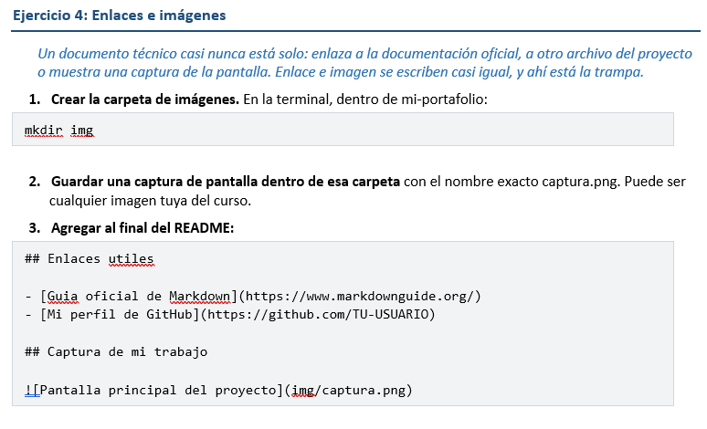

# Guia del proyecto Tienda TECSUP

Esta guia explica el proyecto de practica del Laboratorio 03, pensada para un companero que nunca lo vio.

## Que es el proyecto

Es una pagina web pequena que muestra un carrito de compras con dos productos y calcula el total. El proyecto tiene dos errores que se corrigen con el flujo de fork, issue y pull request.

### Herramientas usadas

- **Git** para el control de versiones
- **GitHub** para el fork, los issues y los pull requests
- *Visual Studio Code* como editor

## Pasos para trabajar con el proyecto

1. Hacer un fork del repositorio del docente
2. Clonar tu fork con `git clone`
3. Entrar a la carpeta con `cd tienda`
4. Abrir `index.html` en el navegador para ver el error
5. Crear una rama, corregir, hacer commit y push
6. Abrir un pull request hacia el repositorio del docente

## Archivos del proyecto

| Archivo | Para que sirve |
|---------|----------------|
| index.html | La pagina: el titulo, la tabla del carrito y el total |
| estilos.css | Los colores y la tipografia |
| script.js | El calculo del total del carrito |

## Comandos principales

```bash
git switch main
git pull
git checkout -b fix-nombre-css
git add index.html
git commit -m "Fix the stylesheet file name in index.html (#26)"
git push origin fix-nombre-css
```

## Mi avance

- [x] Hacer el fork y clonarlo
- [x] Corregir el calculo del total (issue #19)
- [x] Corregir el nombre del archivo CSS (issue #26)
- [ ] Que el docente acepte los pull requests

## Mas informacion

- [Guia oficial de Markdown](https://www.markdownguide.org/)

## Captura de mi trabajo


